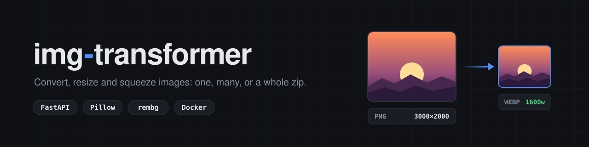
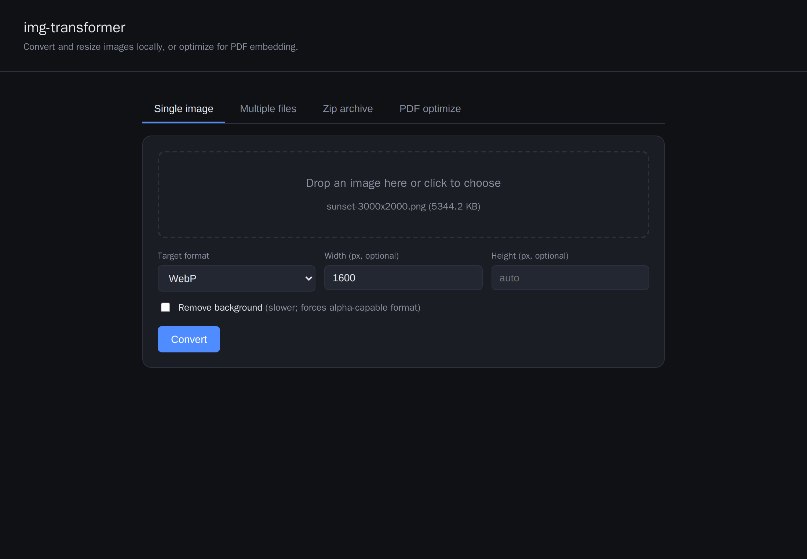
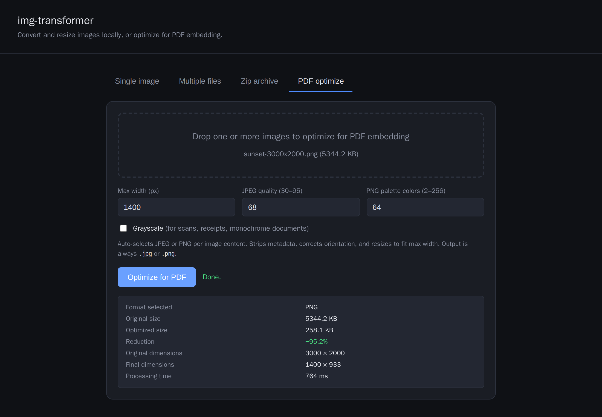

<p align="center">
  
</p>

<p align="center">
  <a href="https://github.com/xMuramasa/img-transformer/actions/workflows/ci.yml"></a>
  
  
  
  <a href="https://docs.astral.sh/uv/"></a>
  <a href="#docker"></a>
  <a href="https://x-muramasa.dev"></a>
</p>

<p align="center">
  A small FastAPI app that converts and resizes images (one file, a batch, or a whole zip archive),<br />
  strips backgrounds, and shrinks images for embedding in PDFs.
</p>

---

## Features

- 🖼️ **Single image**: convert one file (e.g. PNG → WebP), optionally resized.
- 🗂️ **Multiple files**: upload many images, get a zip of converted ones back.
- 📦 **Zip archive**: upload a `.zip`, get a converted `.zip` back, with a per-file report.
- 📄 **PDF optimize**: auto-picks JPEG or PNG per image, strips metadata, fixes orientation, caps width.
- ✂️ **Background removal** (optional): `rembg` + U2Net, for alpha-capable targets.
- 🧩 **Pure-Python core**: `transform/` has no web dependencies, so it works outside the API too.

Formats: `webp`, `png`, `jpeg`, `gif`, `bmp`, `tiff`.

<p align="center">
  
  
</p>
<p align="center"><sub>The drag-and-drop UI: a single conversion, and a PDF optimization run (5.3 MB → 258 KB).</sub></p>

> [!TIP]
> Want to try it without installing anything? The [live demo on x-muramasa.dev](https://x-muramasa.dev)
> runs the same WebP conversion right in your browser.

Originally a Jupyter notebook (`img_to_webp.ipynb`); now a production-shaped app.

## Quick start

Requires [uv](https://docs.astral.sh/uv/) and Python 3.12.

```bash
uv sync --extra dev
uv run uvicorn app.main:app --reload
```

Then open <http://localhost:8000>.

## Project layout

```text
app/                 FastAPI surface
  main.py            routes + static mount
  schemas.py         request validation
  static/index.html  drag-and-drop UI (vanilla JS)
transform/           pure-Python core (no web deps)
  image.py           single-image convert + resize
  archive.py         zip / multi-file conversion
  background.py      optional background removal (rembg)
  pdf_optimizer.py   PDF-embedding optimizer
tests/               pytest suite
```

## Tests

```bash
uv run pytest
```

CI runs the same suite on every push and pull request.

## Docker

```bash
docker build -t img-transformer .
docker run --rm -p 8000:8000 img-transformer
```

The image ships with background removal enabled: `rembg` is installed and the U2Net model
(~170 MB) is downloaded at build time, so the first request doesn't pay for it. The container
runs as a non-root user.

## API

All conversion endpoints accept `multipart/form-data` with form fields
`target_format` (one of `webp`, `png`, `jpeg`, `gif`, `bmp`, `tiff`),
optional `width` / `height` integers, and optional `remove_bg` (boolean).

| Method | Path                      | File field | Response                  |
| ------ | ------------------------- | ---------- | ------------------------- |
| POST   | `/api/convert/image`      | `file`     | converted image           |
| POST   | `/api/optimize/pdf`       | `file`     | optimized jpg/png image   |
| POST   | `/api/optimize/pdf/files` | `files[]`  | zip of optimized images   |
| POST   | `/api/convert/files`      | `files[]`  | zip of converted images   |
| POST   | `/api/convert/zip`        | `file`     | zip of converted images   |
| GET    | `/healthz`                | —          | `{"status": "ok"}`        |

Bulk endpoints include a JSON `X-Conversion-Report` header summarizing
converted / skipped / failed entries.

```bash
curl -F file=@photo.png -F target_format=webp -F width=1600 \
  http://localhost:8000/api/convert/image -o photo.webp
```

`/api/optimize/pdf` accepts `multipart/form-data` with the uploaded `file`
and optional fields:

- `max_width` (default `1400`)
- `jpeg_quality` (default `68`)
- `png_colors` (default `64`)
- `grayscale` (default `false`)
- `max_pixels` (default `40000000`)

The response includes an `X-Optimization-Result` header with optimization
metadata (sizes, dimensions, reduction percentage, selected output format,
and processing duration).

`/api/optimize/pdf/files` accepts the same PDF optimization options and returns
a zip archive of optimized `.jpg` / `.png` assets.

### Background removal (optional)

Install the extra to enable the `remove_bg` flag (uses [`rembg`](https://github.com/danielgatis/rembg)
with the U2Net ONNX model, ~170 MB downloaded on first use):

```bash
uv sync --extra bgremove
```

When `remove_bg=true`, the target format must be alpha-capable
(`webp`, `png`, `gif`, `tiff`). Without the extra installed, the endpoints
return `503` with a clear message.

### Limits

- 50 MB per single image
- 200 MB combined for multi-file uploads
- 200 MB per zip upload

### Security notes

- Zip-slip protection: entries with absolute paths or `..` segments are rejected.
- Target format is allow-listed; arbitrary Pillow format names are not accepted.
- Uploads are processed in-memory and never persisted to disk.

## PDF image optimization pipeline

The project now includes a production-grade optimizer specifically for
PDF embedding workflows where `@react-pdf/renderer` compatibility is the
priority.

- Input formats: `jpeg/jpg`, `png`, `webp`, `tiff`, `bmp`, `gif` (first frame)
- AVIF: accepted only when Pillow has AVIF codec support
- SVG: explicitly rejected (rasterize upstream if needed)
- Output formats: only `jpg` or `png`

### Optimizer API

```python
from transform import optimize_image_for_pdf

result = optimize_image_for_pdf(
  "assets/source-image.webp",
  "build/pdf-assets/source-image",  # suffix auto-normalized to .jpg/.png
  max_width=1400,
  jpeg_quality=68,
  png_colors=64,
  grayscale=False,
)

print(result)
```

Batch processing:

```python
from transform import optimize_many_for_pdf

results = optimize_many_for_pdf([
  ("in/photo1.png", "out/photo1"),
  ("in/ui1.png", "out/ui1"),
])
```

### Configuration options

- `max_width` (default `1400`): downscale only, never upscales
- `jpeg_quality` (default `68`): JPEG quality for photo-like assets
- `png_colors` (default `64`): adaptive palette size for graphics/UI assets
- `grayscale` (default `False`): optional grayscale conversion
- `max_pixels` (default `40_000_000`): safety cap against oversized images

### Heuristics used for JPEG vs PNG

The optimizer classifies each image using a reduced preview and selects the
output format with the best size/quality tradeoff for PDFs:

- transparency coverage (alpha-heavy assets favor PNG)
- unique color count (small palettes favor PNG)
- entropy (high-complexity/noisy content favors JPEG)
- flat-area ratio and UI/screenshot-like structure (favor PNG)

All decisions are logged with metrics and timing.

### Optimization behavior

- EXIF orientation is applied automatically
- metadata is stripped on re-encode (EXIF/ICC and other non-essential payloads)
- JPEG output: progressive, `optimize=True`, subsampling `4:2:0`
- PNG output: adaptive quantization, `optimize=True`, `compress_level=9`

### Benchmark examples

Single file timing:

```bash
uv run python -c "from transform import optimize_image_for_pdf; import time; t=time.perf_counter(); r=optimize_image_for_pdf('in.png','out'); print(r); print('elapsed_ms=', (time.perf_counter()-t)*1000)"
```

Batch timing:

```bash
uv run python -c "from pathlib import Path; from transform import optimize_many_for_pdf; files=[(str(p), str(Path('out')/p.stem)) for p in Path('samples').glob('*')]; print(optimize_many_for_pdf(files))"
```

### Production deployment recommendations

- Keep outputs constrained to JPEG/PNG for renderer stability.
- Start with `jpeg_quality=68`, `png_colors=64`, then tune per dataset.
- Pre-optimize all assets before PDF generation (avoid runtime conversion).
- Keep `max_width` aligned with expected print/screen target DPI.
- Monitor optimizer logs for reduction ratio and misclassification outliers.
- If AVIF is required as input, deploy Pillow with verified AVIF decoding.

## Credits

Built by Martin Salinas with help from GitHub Copilot.
